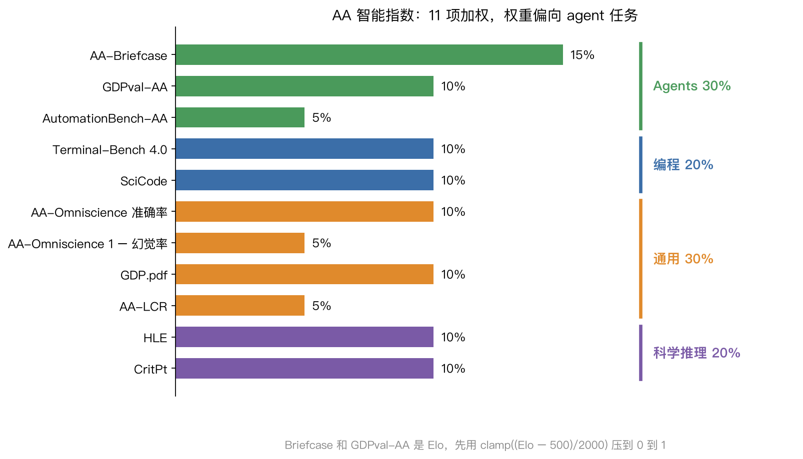
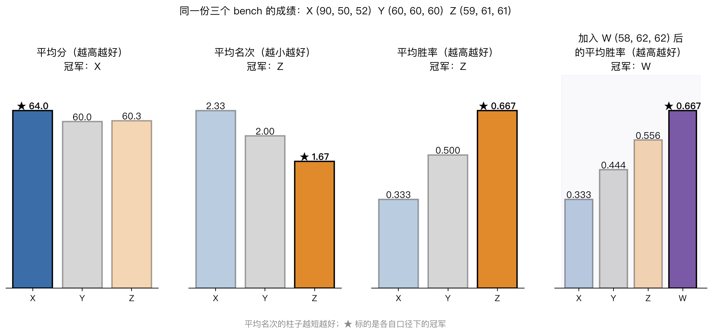

# 第 5 章 跨 bench 合成指数

前面几章的分数都出自一个 bench。模型发布时会报几十个，读者想要一个数。综合指数是对前面那些分数的再汇总，它自己不出题，唯一属于自己的部分就是怎么合。附录收了 8 个这样的指数。

## 5.1 加权和：Artificial Analysis 和 Vals

Artificial Analysis 的智能指数是最常被引用的一个。当前版本有四大类十个组件，其中 AA-Omniscience 又拆成准确率（10%）和"1 − 幻觉率"（5%）两项，所以实际参与加权的是 11 项：

指数就是加权和乘以 100：

$$
\text{Index}=100\times\sum_k w_k\ x_k,\qquad \sum_k w_k=1
$$

两个 Elo 类组件要先压到 0 到 1，用的是

$$
\mathrm{norm}(\text{Elo})=\mathrm{clamp}\Big(\frac{\text{Elo}-500}{2000},\ 0,\ 1\Big)
$$

Elo 1100 对应 0.30，1600 对应 0.55，2600 以上一律是 1。一个虚构模型（`python3 scripts/basics.py` §10）：

| 组件 | 原始成绩 | 组件分 $x_k$ | $w_k x_k$ |
|---|---|---|---|
| AA-Briefcase | Elo 1300 | 0.40 | 0.060 |
| GDPval-AA | Elo 1600 | 0.55 | 0.055 |
| AutomationBench-AA | | 0.50 | 0.025 |
| Terminal-Bench 4.0 | | 0.40 | 0.040 |
| SciCode | | 0.45 | 0.045 |
| Omniscience 准确率 | | 0.50 | 0.050 |
| Omniscience 1 − 幻觉率 | | 0.60 | 0.030 |
| GDP.pdf | | 0.30 | 0.030 |
| AA-LCR | | 0.70 | 0.035 |
| HLE | | 0.30 | 0.030 |
| CritPt | | 0.10 | 0.010 |
| **合计** | | | **0.410 → 指数 41** |

归一化区间决定了组件的实际分量：Elo 每涨 100 分，组件分只涨 0.05，在没碰到上下限时只给指数加 $5\times w$ 分，权重 15% 就是 0.75 分。[3.8 节](chapter3.md#3-8)说过，这两项的 Elo 在模型进入指数时就冻结了。AA 明说权重偏向 agent 任务，指数的版本号一变，组件、判官、锚点都可能跟着变，跨版本不能比（[AA 方法页](https://artificialanalysis.ai/methodology/intelligence-benchmarking)）。

权重是编辑的选择，也就是一种价值判断。Vals Index 把这一点摆到了明面上，按各行业在美国 GDP 中的占比加权。

## 5.2 让数据定权重：Epoch ECI

另一条路是让数据自己决定权重。Epoch 的 ECI 把每个 bench 当成一道"大题"，有难度 $D_b$ 和斜率 $\alpha_b$，每个模型有一个能力 $C_m$：

$$
\text{score}(m,b)=\sigma\big(\alpha_b(C_m-D_b)\big)
$$

这就是项目反应理论，只是题目换成了 bench。只要模型之间在部分 bench 上有重叠，所有模型就能放到同一把尺子上，某个 bench 已经饱和、新模型没测过也能比。

举个例子，三个模型的能力是 0、1、2.5，三个 bench 的难度是 −1、1、3，斜率是 2、1.5、1：

- 能力为 0 的模型没测过最难的 bench，模型预测它只能拿 0.047；
- 能力为 2.5 的模型没测过最简单的 bench，预测是 0.999，已经饱和；
- 同样的能力差，在不同的 bench 上对应完全不同的分数差。

ECI 最后线性缩放到 Claude 3.5 Sonnet = 130、GPT-5 = 150，至少要有 4 个 bench 的成绩才给分（[Epoch ECI](https://epoch.ai/benchmarks/eci)）。

## 5.3 统一成两两对局：Kaggle Game Arena

Kaggle Game Arena 的统一榜收了国际象棋、四子棋、扑克、狼人杀等游戏，各自的分数单位完全不同：国际象棋是 Elo，扑克是 BB/100，狼人杀是均衡胜率。它把所有游戏的对局都化成两两胜负，一起喂给一个 BT，每个游戏除以自己的对局总数，让每个游戏的总权重相同。狼人杀每轮约 37.7 万局，国际象棋约 2200 局，不除的话狼人杀会淹没一切（[Kaggle 博客](https://www.kaggle.com/blog/unified-game-arena-leaderboard)）。代价是扑克只剩"赢没赢"，不再计较赢了多少。

## 5.4 只看名次：平均名次和平均胜率

还有一种合并只看名次，取平均名次或平均胜率。三个模型在三个 bench 上的成绩是 X (90, 50, 52)、Y (60, 60, 60)、Z (59, 61, 61)，用三种算法分别合并：

- **平均分**：偏科的 X 靠一门 90 分夺冠。
- **平均名次、平均胜率**：都让 Z 夺冠。它在后两个 bench 上只比 Y 高 1 分，却拿满了名次。
- **再加一个模型 W = (58, 62, 62)**：平均分里谁也不受影响，平均胜率里 Z 却掉到第二，自己一分没变（`python3 scripts/basics.py` §10）。

这就是 [3.8 节](chapter3.md#3-8)"新模型一来，老分就变"在跨 bench 层的翻版。HELM 在 2025 年 3 月把顶层聚合从平均胜率改成平均分，理由正是这两点。

## 5.5 不合并：帕累托前沿

最后一种选择是不合并。ARC-AGI 的榜把每任务成本和分数画在一张图上；FrontierSWE 第二版画成本和运行时间的帕累托前沿；PutnamBench 在 672 题全部解出以后，按每题平均成本排名。硬要把成本和分数合成一个数，结果取决于怎么合。六个模型（成本美元，分数）分别是 A(0.5, 40)、B(1.2, 55)、C(2, 52)、D(4, 70)、E(9, 71)、F(12, 69)：

- 前沿上是 A、B、D、E；
- 按"分数每美元"排，A 第一；
- 按"分数 − 10·log10(成本)"排，D 第一（`python3 scripts/mechanisms.py` §8）。

**读一个综合指数时先问：**

- 有哪些组件，权重谁定的？
- 不同单位的分数是怎么压到一起的，压的区间会不会让某项几乎不动？
- 加一个新模型，老模型的分或名次会不会变？
- 指数是哪个版本，和别处引用的是不是同一版？

从一条判定到一个指数，分数的算法到这里讲完了。剩下的问题是这个数能信多少，换个温度、换个用户模拟器、换个时间，它会不会变。这是[第 6 章](chapter6.md)的内容。
